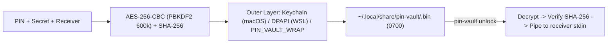

# pin-vault

[](https://github.com/hanzhad/pin-vault/actions/workflows/ci.yml)
[](LICENSE)

One PIN, every token a machine needs handed over after a reboot — without plaintext secrets on disk or in daemon environment variables.

## Why

Local services (CI runner gates, review daemons, dev-container engines) often need long-lived tokens after a reboot. Storing them in `.env` files leaves secrets in plaintext; storing them behind a short PIN alone invites offline brute force if `~/.local/share/pin-vault` is copied.

`pin-vault` solves both:

- **Two-layer encryption:** Every entry is encrypted under a user-supplied PIN (`AES-256-CBC`, `PBKDF2` 600,000 iterations, inside-encryption `SHA-256` digest) and then wrapped with a **machine-bound outer layer** (macOS Login Keychain or Windows DPAPI). A copied `.bin` file is useless on another machine or user account.
- **Zero-argument `stdin` delivery:** `pin-vault unlock` asks for the PIN once and pipes each decrypted secret directly to its configured receiver command on `stdin` — never via CLI arguments or environment variables.
- **Metadata-free rest state:** Without the PIN, `pin-vault status` shows only entry names.

## Architecture



## Quick Start

Install by symlinking `pin-vault` onto your `PATH`:

```sh
ln -s /path/to/pin-vault/pin-vault ~/.local/bin/pin-vault
```

Store a token with a receiver command, inspect stored names, and unlock after reboot:

```sh
# 1. Store a token (prompts hidden for PIN and secret)
pin-vault add ci-gate \
  --receiver "/usr/local/bin/ci-gate-unlock" \
  --note "GitHub runner gate token (rotate quarterly)"

# Multi-line keys (SSH/PEM) can be piped via --stdin:
pin-vault add deploy-key --stdin --receiver "/usr/local/bin/load-key" < ~/.ssh/deploy_key

# 2. List entry names without entering a PIN
pin-vault status
# ci-gate
# deploy-key

# 3. Unlock all entries (or a single name) and pipe each secret to its receiver stdin
pin-vault unlock
# PIN:
# ✓ ci-gate
# ✓ deploy-key
```

## Commands

| Command | What it does |
| --- | --- |
| `add <name> [--stdin] [--receiver <cmd>] [--note <text>]` | Store a new entry. Prompts for receiver, note, and hidden secret (or reads raw bytes from `stdin` with `--stdin`). |
| `get [name]` | Decrypt and print a secret (plus note on `stderr` when piped, or alternate screen on a TTY). Interactive picker when `name` is omitted. |
| `update [name] [--receiver <cmd> \| --note <text> \| --token [--stdin]]` | Update one field of an entry while preserving the other two byte-for-byte. |
| `remove <name>` | Delete an entry after verifying the PIN. |
| `status` | List stored entry names without asking for a PIN. |
| `unlock [name]` | Prompt for the PIN once and pipe each matching secret to its receiver command on `stdin`. |
| `repin` | Re-encrypt every entry in the vault under a new PIN atomically via temporary files. |

## Platform Support & Requirements

- **Runtime dependencies:** `bash` (>= 3.2), `openssl`, `awk`, `base64`
- **macOS (`macos/keychain.sh`):** wraps blobs with a 256-bit random key stored in the login Keychain (`PIN_VAULT_KEYCHAIN_SERVICE`, default `pin-vault`).
- **Windows / WSL (`windows/dpapi.sh`):** wraps blobs with Windows DPAPI (`CurrentUser` scope) via `powershell.exe` over WSL interop. Register the logon unlock window from PowerShell (defaults to WSL `$HOME/Projects/pin-vault` in distro `Ubuntu-24.04`):
  ```powershell
  .\windows\install-logon-task.ps1
  # Or pass an explicit Linux path and distro (do not use ~ in PowerShell):
  .\windows\install-logon-task.ps1 -InstallDir /home/user/Projects/pin-vault -Distro Ubuntu-24.04
  ```
- **Native Linux / headless:** no built-in outer layer is shipped; set `PIN_VAULT_WRAP` to a custom wrapper executable. See [docs/custom-wrapper.md](docs/custom-wrapper.md).

## Documentation & Tests

- [Architecture & Threat Model](docs/architecture.md) — `pin-vault3` record format, PBKDF2/AES/SHA-256 design, and outer layers.
- [Custom Wrapper Guide](docs/custom-wrapper.md) — `PIN_VAULT_WRAP` contract, Linux wrapper recipe, and test environment hooks.
- [Security Policy](SECURITY.md) & [Contributing](CONTRIBUTING.md)

```sh
python3 -m unittest discover -s tests -v
bash tests/test-pin-vault.sh
python3 scripts/scan.py --tree .
python3 scripts/scan.py --history
```

## Local Agentic Engineering Stack

| Repository | Role |
| --- | --- |
| [`agent-dev-slots`](https://github.com/hanzhad/agent-dev-slots) | Isolated, leased dev containers for parallel coding agents |
| [`pin-vault`](https://github.com/hanzhad/pin-vault) *(this repo)* | PIN-protected, machine-bound credential vault with `stdin` daemon unlock |
| [`docker-ci-gate`](https://github.com/hanzhad/docker-ci-gate) | Single-use Docker GitHub Actions runners behind a tmpfs credential gate |
| [`pr-auto-review`](https://github.com/hanzhad/pr-auto-review) | Sandboxed continuous PR auto-reviewer across repositories |
| [`pr-gate`](https://github.com/hanzhad/pr-gate) | Deterministic zero-dependency PR merge gate and NDJSON watcher |
| [`ops-console`](https://github.com/hanzhad/ops-console) | Local operations console for slots, CI gate queue, and GitHub API quota |
